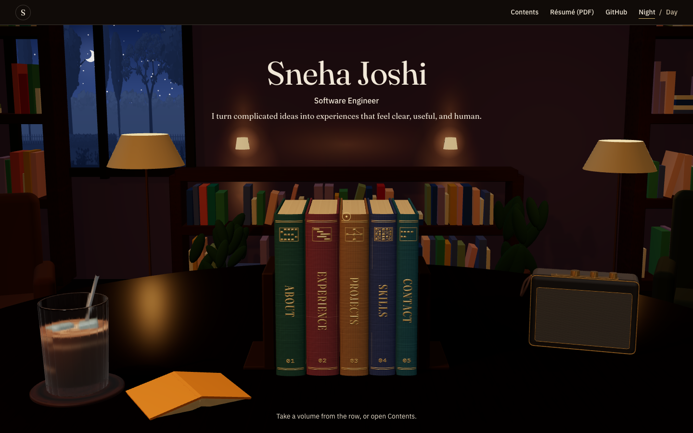

# Sneha Joshi - portfolio

My portfolio as a small 3D bookshop: five books on a reading table, each one a section you can
take out and read.



## Features

- **Five books, five sections.** About, Work Experience, Projects, Skills and Contact. Pick a
  book and it slides out of the row and opens into a two-page spread.
- **Real text on 3D pages.** The pages you read are HTML laid exactly over the open book, so the
  text is selectable, searchable and works with screen readers.
- **Flip cards** for roles and projects: a summary on the front, skills and details on the back.
- **The iced coffee and the speaker** open what I'm reading (from Goodreads) and a playlist (from
  Spotify), served by a small API I built on Cloudflare Workers.
- **Day and Night** modes, with the garden outside the window changing between them.
- **A contact note card** that sends through Web3Forms, with an email fallback.
- **Works without the 3D scene:** keyboard navigation, a Contents menu, reduced-motion support and
  a full fallback when WebGL isn't available.

## Stack

- [Three.js](https://threejs.org) for the scene, [GSAP](https://gsap.com) for the animations,
  [Vite](https://vite.dev) for the build. No UI kit or templates: plain HTML and CSS over the
  canvas.
- No 3D model files. Every object is built from geometry in code, and covers, cloth, wood and the
  garden are painted into canvases in a Web Worker as the page loads.
- A Cloudflare Worker with Workers KV and a cron for the live reading list and playlist.
- Playwright scripts for screenshots, contrast and Lighthouse checks.

## Run locally

Node 20 or later.

```bash
npm install
npm run dev        # http://localhost:5173
npm run build      # production build in dist/
```

Optional settings go in `.env` (copy `.env.example`): `VITE_WEB3FORMS_KEY` for the contact form
and `VITE_API_BASE` for the live API. Without them the site uses the data it was built with.

Checks (they drive Chrome headless with software WebGL, so they're slow):

```bash
npm run screenshots        # every state, both modes, desktop and phone → screenshots/
npm run check:contrast     # WCAG contrast of text against the rendered scene
npm run check:lighthouse   # Lighthouse performance and accessibility
npm run measure            # draw calls, triangles, bundle sizes
```

## Project structure

| Path           | What                                                                         |
| -------------- | ---------------------------------------------------------------------------- |
| `src/data/`    | All the content: sections, profile, links, photos, reading list and playlist |
| `src/scene/`   | Scene setup, renderer, camera, lights and the layout for each screen shape   |
| `src/objects/` | The books (cover art, motifs, opening), the iced coffee and the speaker      |
| `src/world/`   | Room, table and window view                                                  |
| `src/paint/`   | Procedural textures, painted in a Web Worker                                 |
| `src/ui/`      | Reader, flip cards, cards, contents menu and the open/close controller       |
| `src/theme/`   | Day and Night presets and the toggle                                         |
| `src/config/`  | Motion and colour tokens shared by the CSS and the 3D scene                  |
| `scripts/`     | Build-time asset scripts (covers, photos, playlist) and the checks above     |
| `worker/`      | The API worker (its own package; see [worker/README.md](worker/README.md))   |
| `docs/`        | [Engineering notes](docs/engineering-notes.md) and the README screenshot     |

## The API worker

`worker/` is a Cloudflare Worker that serves `/reading` (my Goodreads shelves) and `/playlist`
(a Spotify playlist). A cron refreshes both into Workers KV every six hours and requests are
answered from KV, so visitors never wait on Goodreads or Spotify. If either is down, the Worker
keeps serving the last good data; if the Worker is unreachable, the site keeps the data it was
built with. Setup, secrets and rotation are in [worker/README.md](worker/README.md).

To pick up shelf or playlist changes right away instead of at the next cron, clear the cached
entries in KV; the next request fetches fresh data:

```bash
cd worker && npm run refresh   # or refresh:reading / refresh:playlist
```

## Deploy

`.github/workflows/deploy.yml` builds the site and publishes it to GitHub Pages on every push to
`main`. The Worker is deployed separately with `npx wrangler deploy` in `worker/`.

## Credits

- Fonts: [Fraunces](https://fonts.google.com/specimen/Fraunces),
  [IBM Plex Sans and IBM Plex Mono](https://fonts.google.com/specimen/IBM+Plex+Sans), from Google
  Fonts.
- Book covers: [Open Library](https://openlibrary.org) Covers API, downloaded at build time.
- Playlist name, cover and album art: Spotify.
- Organisation logos belong to Arizona State University and Mentamorph Money.
